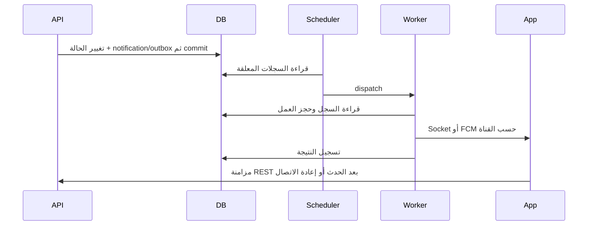

# Outbox ومنع تكرار العمليات

[الفهرس](../README.md) · [الدفع](../Client/payments.md) · [التشغيل](../Operations/commands.md)

## كيف يصل إشعار مع تغيير حالة؟

تكتب الخدمة إشعار user_notifications وسجلات التسليم ضمن المعاملة المناسبة لتغيير الحالة. هذا هو durable outbox الخاص بالإشعارات. scheduler يعثر على العمل غير المنشور، والـqueue ينشر Socket ويرسل القنوات المهيأة. فشل المزود لا يلغي السجل المحلي؛ يعاد التسليم وفق حالته ومحاولاته.



التسليم at least once؛ تعطل العامل بعد إرسال خارجي وقبل تسجيل النجاح قد يسبب تكرارًا. ادمج الإشعارات بالـid وrevision. أحداث حالة الصندوق قد تصل بتكرار/ترتيب مختلف، لذلك REST هو مصدر المصالحة. Client لا يستقبل Email، وPush اختياري؛ عدم إعداد FCM لا يمنع الإشعار داخل الحساب.

`notifications:publish-pending` يعمل كل دقيقة. قناة خارجية تفشل حتى 8 محاولات ثم تصبح failed؛ عالج السبب قبل إعادة العمل بإجراء تشغيلي مدروس. لا يوجد endpoint للعميل لإدارة outbox أوإرسال إشعار arbitrary.

## المفاتيح التي يرسلها المطور

| العملية | المفتاح | عند إعادة المحاولة |
|---|---|---|
| إنشاء دفعة/استرداد/تسوية محفظة | `Idempotency-Key` header | نفس المفتاح والحمولة؛ التغيير 409 |
| عملية MyFatoorah تغيّر حالة | `Idempotency-Key` header | الناجحة تسترجع النتيجة؛ المجهولة تتطلب reconciliation |
| نموذج تواصل | `request_id` UUID | نفس المرجع للطلب نفسه؛ تغيير البيانات 409 |
| إنشاء محادثة | `request_id` UUID | نفس المحادثة للطلب نفسه |
| رسالة دعم | `client_message_id` UUID | نفس الرسالة والنص ومجموعة media_ids |
| تعديلات الصفحة/الدعم/التواصل | `draft_version` أو`version` | قفل تفاؤلي؛ أعد القراءة عند 409، ليس مفتاح idempotency |

المفتاح المالي 1–128 حرفًا وفق عقد request، من الحروف والأرقام والرموز `._:-`. خزّنه قبل الإرسال. اربط كل زر عملية بمعرف ثابت حتى تعرف نتيجته؛ ضغط retry لا ينشئ UUID آخر.

```http
POST /api/v1/client/payments
Authorization: Bearer CLIENT_TOKEN
Idempotency-Key: 88888888-8888-4888-8888-888888888888
Content-Type: application/json
```

```json
{"provider":"stripe","currency":"EGP","amount":1500}
```

إذا انقطع الاتصال أعد الطلب نفسه. إذا احتجت مبلغًا مختلفًا، تحقّق أولًا من نتيجة العملية القديمة؛ تعديل المبلغ مع مفتاحها يعيد IDEMPOTENCY_CONFLICT. نجاح إنشاء payment لا يعني نجاح التحصيل.

## حدود منع التكرار المالية

السجل المالي مقفل أثناء التغيير وتُحفظ حركات ledger بدل تعديل تاريخها. التسوية المكررة من webhook لا تضاعف الرصيد. الاسترداد يحجز الخصم قبل الاتصال؛ الفشل المؤكد يحرره والنتيجة المجهولة تبقيه معلقًا.

التطبيق يوقف إعادة إنشاء العمليات غير المحسومة بعد 23 ساعة مع Stripe و 240 دقيقة مع MyFatoorah. استخدم payments:reconcile للقراءة من المزود وتسوية الحالة؛ لا تنشئ مفتاحًا جديدًا لتجاوز الحد. العمليات التجارية MyFatoorah لها سجل مستقل وتسوية يدوية موثقة عند الحاجة، ولا تحرك محفظة العميل.

مصادر: [NotificationOutbox](../../app/Services/Notifications/NotificationOutbox.php)، [الجدولة](../../routes/console.php)، [الدليل المالي](payment-providers.md).
